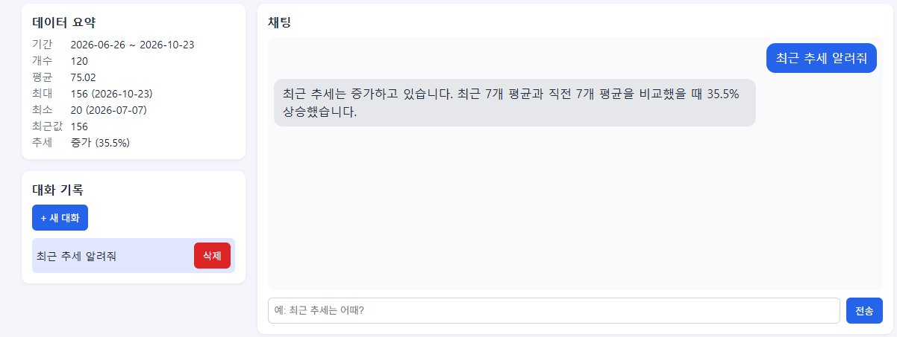
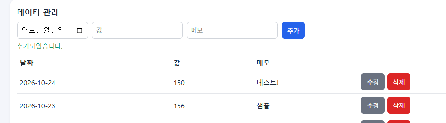
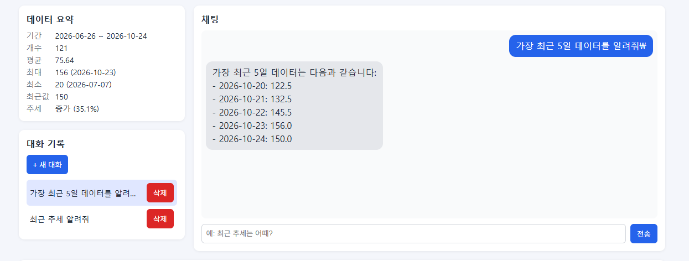

# 데이터 기반 AI 채팅

시계열 데이터(일별 학습 시간)를 저장·관리하고, 그 데이터의 **요약 정보(기간·개수·평균·최대/최소·최근 추세)를 시스템 프롬프트에 주입**해 GPT가 내 데이터에 근거해 답변하는 웹 서비스입니다. 대화는 자동 저장되어 나중에 다시 불러올 수 있습니다.

> "요즘 학습 시간이 늘고 있어?", "가장 많이 공부한 날은 언제야?" 같은 질문에 AI가 저장된 데이터를 바탕으로 답합니다.

## 주요 기능

| 기능 | 설명 |
|---|---|
| 데이터 기반 AI 채팅 | 질문 시 데이터 요약을 조회해 시스템 프롬프트에 삽입한 뒤 GPT를 호출. 답변 생성 중 로딩 표시 |
| 데이터 관리 (CRUD) | `(date, value, memo)` 데이터를 추가·수정·삭제하고 목록과 요약을 즉시 갱신 |
| 대화 기록 | 대화 자동 저장, 목록 조회, 특정 대화 불러오기, 삭제 |
| 데이터 요약 | 기간, 개수, 평균, 최대/최소, 최근값, 추세(증가/감소/유지)를 화면에 표시 |

## 배포 URL

| 구분 | URL |
|---|---|
| Frontend (Vercel) | https://m1-2-frontend-five.vercel.app |
| Backend API (Render) | https://aichat-sec5.onrender.com |
| Swagger UI | https://aichat-sec5.onrender.com/docs |

> **콜드스타트 안내**: 백엔드는 Render 무료 플랜이라 15분 이상 요청이 없으면 슬립 상태가 됩니다. 이때 첫 요청은 **최대 1분 정도** 걸릴 수 있습니다. 화면에는 "서버를 깨우는 중입니다" 안내가 표시되며, 서버가 깨어난 뒤에는 정상 속도로 동작합니다.

## 기술 스택

- **Backend**: Python 3.12, FastAPI, Pydantic, Uvicorn
- **Database**: Firebase Firestore (`firebase-admin`)
- **AI**: OpenAI API (`gpt-4o-mini`)
- **Frontend**: HTML / CSS / Vanilla JavaScript (프레임워크 미사용)
- **Deploy**: Render (백엔드), Vercel (프론트엔드)

## 프로젝트 구조

```
timeseries-chat-app/
├─ backend/
│  ├─ main.py                # FastAPI 앱 초기화, CORS, 라우터 등록
│  ├─ config.py              # 환경변수 로딩
│  ├─ firebase.py            # Firestore 클라이언트 초기화
│  ├─ schemas.py             # Pydantic 요청 검증 모델
│  ├─ seed.py                # 샘플 데이터 120개 업로드 스크립트
│  ├─ requirements.txt
│  ├─ .env.example
│  ├─ routers/               # HTTP 계층 (요청/응답, 상태 코드)
│  │  ├─ data.py
│  │  ├─ conversations.py
│  │  └─ chat.py
│  └─ services/              # 비즈니스 로직, DB 접근
│     ├─ data_service.py
│     ├─ conv_service.py
│     └─ summary.py          # 시계열 요약 계산
├─ frontend/
│  ├─ index.html
│  ├─ style.css
│  ├─ app.js
│  ├─ config.js              # API 주소 (Vercel 빌드 시 build.js가 생성)
│  ├─ build.js
│  └─ vercel.json
├─ screenshots/
└─ README.md
```

- `routers/`는 요청을 받고 응답을 돌려주는 역할만, `services/`는 Firestore 접근과 요약 계산을 맡도록 분리했습니다.

## 데이터와 요약

- 데이터: 일별 학습 시간(분) 120개 (`seed.py`로 생성한 샘플 데이터, 2026-06 ~ 2026-10)
- 저장 형식: `date`(YYYY-MM-DD), `value`(숫자), `memo`(최대 200자)

`GET /api/data/summary`가 반환하는 요약:

| 필드 | 설명 |
|---|---|
| `count` | 데이터 개수 |
| `start_date`, `end_date` | 데이터 기간 |
| `mean` | 평균 |
| `max`, `min` | 최대/최소 값과 날짜 |
| `latest` | 가장 최근 값 |
| `trend`, `trend_change_pct` | 최근 7개 평균과 직전 7개 평균을 비교해 ±3% 이내면 "유지", 넘으면 "증가"/"감소" |
| `recent_points` | 최근 5개 데이터 |

## 컨텍스트 주입 흐름 (`POST /api/chat`)

1. 데이터 요약 조회 (`/api/data/summary`와 같은 로직)
2. 요약을 텍스트로 만들어 시스템 프롬프트의 `[데이터 요약]` 자리에 삽입
3. 시스템 프롬프트 + 최근 메시지 10개 + 사용자 질문으로 GPT 호출 (`max_tokens=500`)
4. 질문과 답변을 `conversations` 컬렉션에 자동 저장하고 `reply`, `conversation_id` 반환

시스템 프롬프트는 "요약에 없는 내용은 모른다고 답하라"고 지시해, 저장된 데이터에 근거한 답변을 하도록 했습니다.

## API

| Method | Path | 설명 |
|---|---|---|
| POST | `/api/data` | 데이터 추가 |
| GET | `/api/data` | 데이터 목록 조회 (날짜순) |
| PUT | `/api/data/{id}` | 데이터 수정 |
| DELETE | `/api/data/{id}` | 데이터 삭제 |
| GET | `/api/data/summary` | 데이터 요약 (프롬프트 주입용) |
| POST | `/api/conversations` | 대화 저장 |
| GET | `/api/conversations` | 대화 목록 조회 (**messages 미포함**) |
| GET | `/api/conversations/{id}` | 특정 대화의 전체 messages 조회 |
| DELETE | `/api/conversations/{id}` | 대화 삭제 |
| POST | `/api/chat` | AI 채팅 (요약 주입 → GPT 호출 → 자동 저장) |
| GET | `/health` | 상태 확인 |

- 입력값은 Pydantic으로 검증합니다. (날짜 형식, `memo` 길이, 메시지 길이 등) 형식이 틀리면 `422`를 반환합니다.
- 존재하지 않는 id는 `404`, AI 호출 실패는 `502`로 응답합니다.

## Firestore 컬렉션 구조

```
data/{id}
  date: "2026-10-22"
  value: 145.5
  memo: "샘플"

conversations/{id}
  title: "최근 추세 알려줘"
  messages: [{ role: "user" | "assistant", content: "..." }, ...]
  created_at, updated_at: ISO 문자열
```

## 로컬 실행 방법

사전 준비: Python 3.10 이상, Firebase 프로젝트(Firestore 활성화, 서비스 계정 키), OpenAI API 키

### 1. 백엔드

```bash
cd backend
python -m venv venv
venv\Scripts\activate           # macOS/Linux: source venv/bin/activate
python -m pip install -r requirements.txt
```

`backend/.env.example`을 복사해 `backend/.env`를 만들고 값을 채웁니다. (아래 환경변수 표 참고)

```bash
python seed.py                              # 샘플 데이터 120개 업로드 (최초 1회만)
python -m uvicorn main:app --reload         # http://localhost:8000/docs
```

`seed.py`는 한 번만 실행하세요. 다시 실행하면 데이터가 중복됩니다.

### 2. 프론트엔드

```bash
cd frontend
python -m http.server 5500                  # http://localhost:5500
```

`frontend/config.js`의 `API_BASE_URL`이 `http://localhost:8000`인지 확인하세요. 백엔드 `.env`의 `ALLOWED_ORIGINS`에 `http://localhost:5500`이 들어 있어야 합니다.

## 환경변수

### Backend (`backend/.env` 또는 Render Environment)

| 이름 | 필수 | 설명 |
|---|---|---|
| `OPENAI_API_KEY` | O | OpenAI API 키 |
| `OPENAI_MODEL` | | 사용 모델 (기본값 `gpt-4o-mini`) |
| `FIREBASE_SERVICE_ACCOUNT_JSON` | O | 서비스 계정 키. 로컬은 JSON 파일 경로(`./serviceAccountKey.json`), 배포는 **JSON 내용 전체** |
| `ALLOWED_ORIGINS` | O | CORS 허용 도메인 (쉼표 구분, 예: `https://m1-2-frontend-five.vercel.app,http://localhost:5500`) |
| `PYTHON_VERSION` | | Render 빌드용 파이썬 버전 (예: `3.12.10`) |

### Frontend (Vercel Environment Variables)

| 이름 | 필수 | 설명 |
|---|---|---|
| `API_BASE_URL` | O | 백엔드 주소 (예: `https://aichat-sec5.onrender.com`, 끝에 `/` 없이) |

환경변수를 바꾸면 Render는 자동 재배포되고, Vercel은 **다시 배포**해야 반영됩니다.

## 배포 방법

### Backend → Render

1. GitHub에 코드를 푸시
2. Render에서 **Web Service** 생성
   - Root Directory: `timeseries-chat-app/backend`
   - Build Command: `pip install -r requirements.txt`
   - Start Command: `uvicorn main:app --host 0.0.0.0 --port $PORT`
3. 위 환경변수 등록 후 배포 → `/docs`에서 Swagger 확인

### Frontend → Vercel

1. Vercel에서 같은 저장소를 Import
2. Root Directory: `timeseries-chat-app/frontend`, Framework Preset: `Other`
3. 환경변수 `API_BASE_URL` 등록 후 배포 (`vercel.json`이 빌드 시 `node build.js`를 실행해 `config.js`를 생성)
4. 배포된 Vercel 주소를 백엔드의 `ALLOWED_ORIGINS`에 추가

## 보안 및 운영

- API 키와 서비스 계정 키는 **환경변수로만 관리**하며 코드와 저장소에 포함하지 않습니다. (`.env`, `serviceAccountKey.json`은 `.gitignore` 처리)
- CORS는 `ALLOWED_ORIGINS`에 등록한 도메인에서 온 요청만 허용합니다.
- 입력값은 Pydantic으로 검증하고, 예외는 상태 코드와 메시지로 응답합니다.
- 비용 관리를 위해 `max_tokens=500`, 대화 기록 최근 메시지 10개 제한, 소규모 샘플 데이터로 테스트했습니다.
- 프론트엔드는 응답 내용을 `textContent`로 렌더링해 HTML 삽입(XSS)을 방지합니다.

## 제출 스크린샷

### 1. 데이터 요약이 보이는 채팅 화면 (질문 + 답변)



### 2. 데이터 관리 화면 (CRUD 동작)



### 3. 대화 기록 화면 (불러오기 동작)


